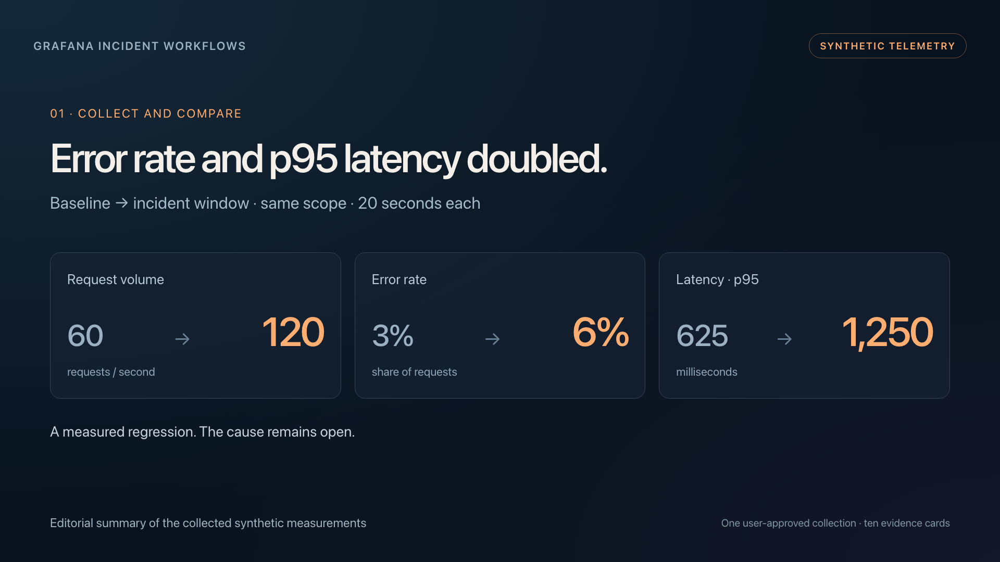

# Grafana incident workflow recording

**[Watch the walkthrough · 1:45](media/grafana-incident-workflows.mp4)** · [Full recording · 2:48](media/grafana-incident-workflows-full.mp4) · [Run and editing receipt](media/grafana-incident-workflows.json)

This recording shows real Codex model turns using the two new Grafana incident skills and the packaged MCP server against the signed synthetic onboarding provider. The browser is a purpose-built recording console, not the Codex or Grafana product interface. Its tool activity, measurements, and drafts come from the actual run.

The recorded source revision is [337528f](https://github.com/openai/community-plugins/tree/337528fa1e79f44e7bb7d4d232351c4988c0c2c9). Later PR review clarified setup and missing-field guidance. The MCP runtime and original recording remain unchanged; the edited walkthrough was polished for readability. The [evaluation guide](grafana-incident-evaluations.md) documents qualification of the final package.

## What happens

1. Codex discovers the packaged skills and connects to the synthetic provider.
2. `$coordinate-grafana-incident` checks the profile and available packs, collects one bounded APM report, opens its evidence cards and source link, and drafts an incident handoff.
3. `$review-grafana-incident` reopens the original evidence in the same active Codex/MCP session and drafts the incident review. It does not collect a new current-health window.

The current report contains **120 requests/second, 6% errors, and 1,250 ms p95 latency**. Its equal-duration baseline contains **60 requests/second, 3% errors, and 625 ms p95 latency**. These are generated synthetic measurements. The drafts preserve partial readiness and uncertainty about cause and recovery.

The successful take used Codex CLI **0.144.3** with `gpt-5.6-sol`: **two model turns, 19 MCP calls, one user-approved collection, and ten provider reads**. Read the exact [incident handoff](media/grafana-incident-workflows-coordinate.md), [incident review](media/grafana-incident-workflows-review.md), and [normalized tool receipts](media/grafana-incident-workflows-evidence.json).

## Recording and qualification boundaries

The walkthrough cuts waiting and selected reading intervals, adds editorial summary cards, and enlarges portions of the recorded output pane. It holds a captured final frame for 14.5 seconds for reading. Moving footage plays at normal speed. The close-ups and synthetic labels are editorial framing; recorded measurements and model text remain unchanged. The poster summarizes the same synthetic measurements. The full recording preserves the complete successful run, uncut at normal speed. Both videos are silent, 1920 × 1080 H.264 MP4s.

The runner loads exact copies of the checkout's packaged skills through native Codex skill discovery and uses the actual packaged MCP process. It does not install the plugin into the user's global configuration. This demonstrates the two model-driven workflows on synthetic telemetry; installed-package qualification and real-provider integration remain separate checks described in the [onboarding guide](grafana-synthetic-onboarding.md) and [behavioral evaluation guide](grafana-incident-evaluations.md).

Report references belong to the active MCP process. Keep that session open when reopening evidence. Starting another server does not make earlier references accessible. For a historical review in another session, provide the captured record and retain its retrieval and freshness limitations. Source links in these receipts point to an ended local fixture session, not a live Grafana dashboard.

## Try the workflows

**Previewing PR #48 before merge?** Use the [draft branch setup](grafana-synthetic-onboarding.md#preview-a-draft-pr), then follow the copy-ready installation and drafting prompts. Installing from `main` selects the merged release, which may not contain these new skills yet.

To try drafting without Grafana credentials, follow [synthetic onboarding](grafana-synthetic-onboarding.md) and provide its exported evidence packet to the two skills as a frozen synthetic record. That command closes its provider when it finishes. The recording uses a local companion that keeps the provider and MCP session open for both turns; the recording console is not a shipped plugin interface. Model turns still use the user's normal Codex account.

For connected collection, [install and configure Grafana Observability](../plugins/grafana-observability/README.md) with an administrator-approved read-only profile. Use the two prompts in the plugin's **Incident workflows** section in one active Codex task. The default installed fixture profile has no active packs; installation alone does not reproduce this collection run.

For production use, provide the approved profile, service scope, incident window, and equal-duration baseline. Let existing Grafana alerting and on-call procedures trigger the task. The skills produce drafts for human review; they do not add background monitoring, paging, messaging, or remediation.
