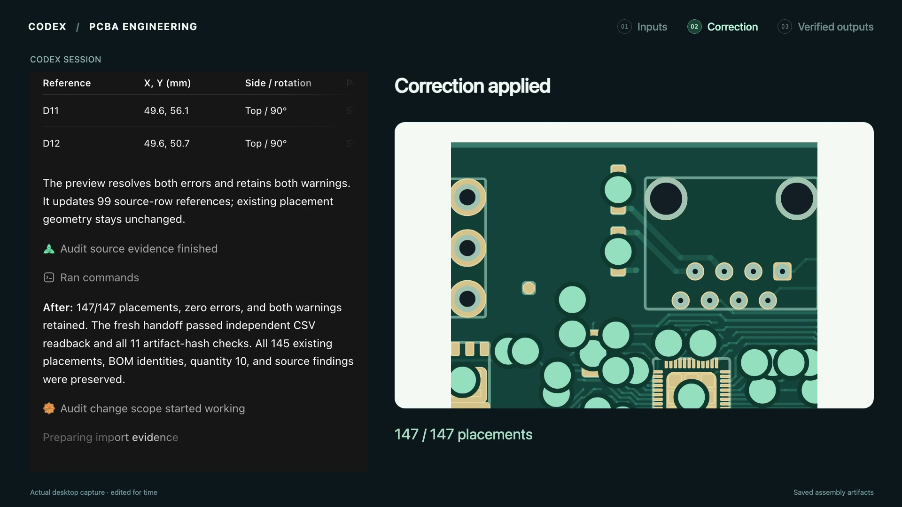

# Drone BMS: PCBA Engineering in Codex

[](pcba-engineering-drone-bms-2m27s.mp4)

**[Watch the full demo — 2:27](pcba-engineering-drone-bms-2m27s.mp4)** · [Captions](captions.vtt) · [Transcript](transcript.txt) · [Open the actual assembly guide](handoff/assembly-guide.html)

**Inputs → correction → verified outputs.** A v0.2 BOM and source board are paired
with an older placement export. Codex finds D11/D12 missing, previews and applies
the two source-backed additions, then reopens and verifies the 11 exported
artifacts. All 145 existing placements and both source warnings are preserved.
The mismatch comes from two public Libre Solar board revisions.

The movie contains 84 seconds of actual Codex interaction at normal speed,
intercut with separately labeled saved board visuals. Personal paths and
unrelated app chrome are masked. It records plugin **0.1.2**; the current
**0.1.3** package additionally rejects ambiguous input references early.

The reusable plugin accepts mapped CSV or canonical JSON and has no OpenPnP,
account, network or media-tool dependency. [Replay the public BMS scenario](../../pcba-engineering-bms-demo.md)
or [use your own assembly files](../../../plugins/pcba-engineering/README.md).
The recorded packet pins its original verifier version. To verify it from the
repository root, extract the small [0.1.2 verifier snapshot](recorded-verifier-0.1.2.zip)
without installing it:

```sh
unzip -n docs/media/pcba-engineering/recorded-verifier-0.1.2.zip \
  -d work/pcba-engineering/recorded-verifier
node work/pcba-engineering/recorded-verifier/pcba-engineering/scripts/pcba.mjs \
  verify-handoff --directory docs/media/pcba-engineering/handoff
```

Download the handoff folder to open its self-contained guide locally; GitHub
shows its source. Verification establishes document consistency. R59 population
and missing part identities remain unresolved; electrical, physical assembly
and flight qualification are not claimed. Native SVG preview failed in the
recorded take; the exported HTML guide passed a separate in-app-browser check.

[Provenance and attribution](ATTRIBUTION.md) · [Edit receipt](provenance.json) ·
[Recorded acceptance](recorded-run-acceptance.json) · [Technical QA](media-qa.json)
