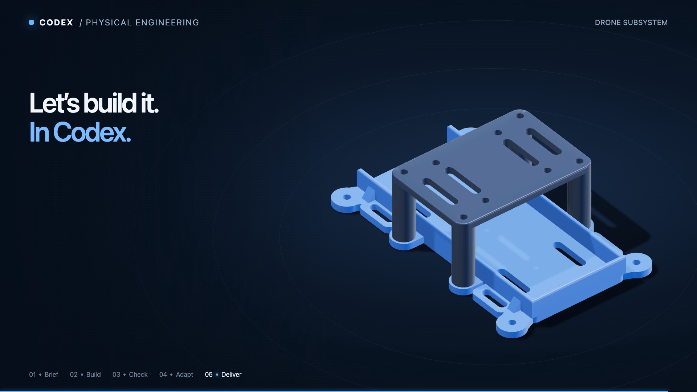

# Physical Engineering demo

**[Watch the two-minute demo](physical-engineering-from-brief.mp4)** ·
[Captions: SRT](physical-engineering-from-brief.srt) ·
[Captions: VTT](physical-engineering-from-brief.vtt) ·
[Run it live](../../physical-engineering-demo-runbook.md)

Build a battery tray and removable electronics bridge from a brief. Check the
fit, introduce a wider battery, preserve the failure, then revise the design
and deliver checked CAD. This is one worked example of the plugin's workflow;
the installed package does not depend on these media files.

## Source and review

This narrated animation uses actual CAD construction stages, sections and
separately rebuilt geometry. It introduces the live exercise; it is not a
continuous screen recording. The video bytes are unchanged from the reviewed
delivery. The poster is its unaltered frame at 115 seconds.

The [manifest](manifest.json) records file hashes, source revisions, geometry
provenance and review coverage. CAD evidence belongs to
[`272007a`](https://github.com/openai/community-plugins/commit/272007ab1f52aba07f931b37452bfd9153fd1e87)
and plugin `0.1.0-preview.2`; presentation source belongs to
[`8ecb36b`](https://github.com/openai/community-plugins/commit/8ecb36b57469cf7258f42ca0ffbc043bf810570c).
It does not establish acceptance of subsequent plugin changes or physical
fabrication, retention, strength or flight performance.

Full video/audio decoding and caption agreement passed. Twelve decoded frames
were visually reviewed for narrative, measurements, legibility and clipping.
The source delivery kit's text, PDFs, metadata and embedded assets were scanned
for private paths and tokens with no findings. Review was sampled: continuous
perceptual playback, listening and native-player subtitle layout were not
assessed. The [build guide](../../../tests/physical-engineering/support/showcase/README.md)
describes the rendering and verification process.

## License and generation tools

Original media, captions and presentation source use the repository's
[Apache-2.0 license](../../../LICENSE). Rendering used Three.js 0.185.1
([MIT notice](licenses/three-MIT.txt)). Narration used kokoro-onnx 0.6.1
([MIT notice](licenses/kokoro-onnx-MIT.txt)), Kokoro-82M v1.0
([Apache-2.0](licenses/Apache-2.0.txt)) and the stock `af_heart` voice; no voice
cloning was used. Model provenance and exact upstream asset hashes are in the
[narration source manifest](../../../tests/physical-engineering/support/showcase/narration/assets.json).
No runtime, model weights or voice embeddings are distributed here.
